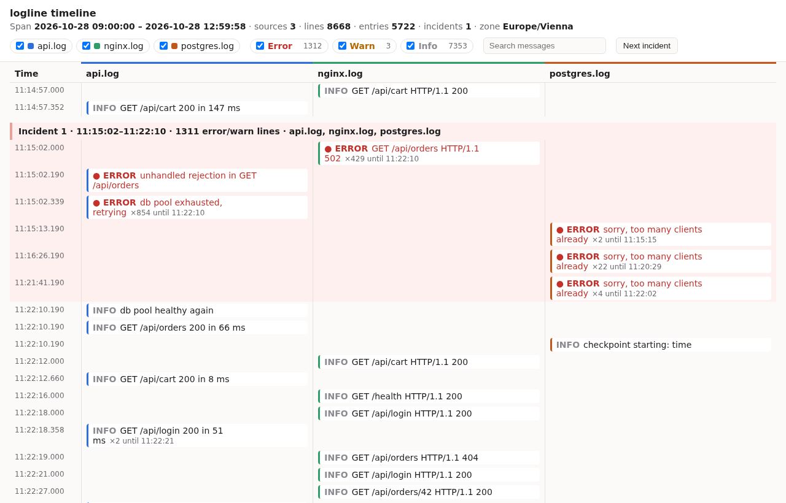

# logline

Logs from several sources merged into one timeline you can read in a minute. A log viewer shows
one file at a time; logline puts them side by side:

- **one timeline:** several files, or `docker compose logs -t` on stdin, merged by time;
- **repeats collapsed:** "db pool exhausted, retrying ×854, 11:15:02–11:22:10" is one entry;
- **incidents:** 5 or more error/warn lines within 60 s, across all sources, become a band with
  its start, end and the sources involved;
- **one HTML file:** no server, no network; open it from disk or attach it to a ticket.



(The demo logs from `logline demo`, shown in Vienna time: the database runs out of connections,
the API retries hundreds of times, nginx returns 502s, then everything recovers.)

## Commands

```sh
logline app.log db.log proxy.log -o timeline.html      # merge three files into one HTML timeline
docker compose logs -t --no-color | logline - -o t.html  # stdin; split by the "service |" prefix
logline app.log db.log --format text                     # colored terminal output instead of HTML
logline demo --out demo/                                 # writes demo logs of a made-up incident
```

With `cargo`: `cargo run --release -p logline -- demo --out demo/`, then
`cargo run --release -p logline -- demo/*.log -o timeline.html`.

The page has a lane per source, filters by source and level, a search box, and a "Next incident"
button. Click a collapsed entry to see its raw lines (the first 5 and the last 5).

## Formats and levels

Each line is recognized on its own:

| Format | Example | Level |
|---|---|---|
| JSON | `{"ts":"…","level":"error","msg":"…"}` | `level` / `lvl` / `severity` |
| logfmt | `time=… level=warn msg="slow query"` | `level` / `lvl` / `severity` |
| syslog (RFC 5424, 3164) | `<11>1 2026-10-28T10:15:00Z host app …` | priority 0–3 error, 4 warn, else info |
| nginx/Apache combined | `1.2.3.4 - - [28/Oct/2026:10:15:00 +0000] "GET /" 502 …` | 5xx error, everything else info |
| Postgres | `2026-10-28 10:15:00.123 UTC [77] FATAL:  …` | `ERROR`/`FATAL`/`PANIC` error, `WARNING` warn |
| plain | `2026-10-28 10:15:00,001 [WARN] cache miss` | a level word near the start, else info |

A line without a timestamp (a stack trace, wrapped output) belongs to the line before it. A
line that matches nothing is kept as text, never dropped. Log text is data, never markup: every
string is escaped, so a line containing `<script>` shows as text.

## Options

| Flag | Default | What it does |
|---|---|---|
| `--tz ZONE` | `UTC` | zone for timestamps that carry none, and for display (`Europe/Vienna`, `+02:00`) |
| `--shift NAME=DUR` | | move one source's clock, e.g. `--shift db=+2s` |
| `--from` / `--to TIME` | | keep only lines inside this window |
| `--collapse-gap DUR` | `60s` | repeats further apart start a new entry |
| `--incident-min N` / `--incident-window DUR` | `5` / `60s` | error/warn lines that make an incident |
| `--max-entries N` | `50000` | later entries are cut by time; the summary says where and suggests `--from` |
| `--year N` | this year | for syslog lines that have no year |
| `--stats` | | lines read, lines per second and collapse ratio on stderr |

## Throughput

On the dev machine (AMD Ryzen 5 2500U, 4 cores / 8 threads, one thread used), a 1.06 GB demo
file set (`logline demo --scale 1270`, 10.97 million lines) takes about 29 s with
`--release --format text -o /dev/null`: **about 380,000 lines/s, 37 MB/s**, with a peak of 29 MB
of memory. Input is streamed; memory grows with the entries kept, not with the input size.

## Test

```sh
cargo test -p logline
```
